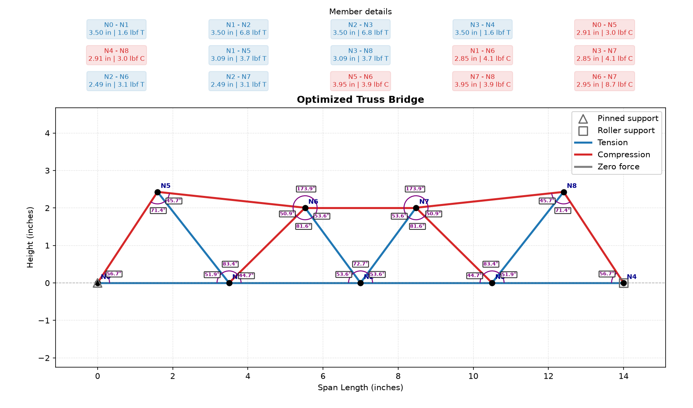

# Truss-Optimizer-Algorithm

2026-2027 SOLS Science Fair Submission

2D direct-stiffness truss solver and genetic algorithm for birch/popsicle-stick bridge layouts under a max stick length limit.

Solves 2D pin-jointed truss displacements and axial forces (solve_truss)

Estimates tension and Euler buckling limits with a safety factor (find_estimated_capacity)

Evolves symmetric trusses in a GA (run_genetic_algorithm), filtering out disconnected graphs, intersecting members, singular stiffness matrices, and members over MAX_STICK_LENGTH_IN

Plots member forces, lengths, and joint angles (plot_stress_graph, detect_all_joint_angles)

Key settings
MAX_STICK_LENGTH_IN = 4.5 — max member length in inches

RANDOM_SEED = an integer to determine how the algorithm generates its design. The digit entered correlates to a specific design. Keep as "None" for a random design.

TEST_MARBLE_COUNT = 500.0 (MARBLE_MASS_GRAMS = 4.5) — target load

WOOD_MODULUS_PSI, ESTIMATED_TENSILE_STRENGTH_PSI, STICK_WIDTH_IN, STICK_THICKNESS_IN, SAFETY_FACTOR — material & build specs. Change for different materials.

POPULATION_SIZE, NUM_GENERATIONS, MUTATION_RATE, MUTATION_STRENGTH — GA controls, used in this program as estabilished defaults. Not recommendable to change.

Note: Gusset plates are also included in the schematic, one for each node. Not diagrammed due to redundancy.

Example Graph:

